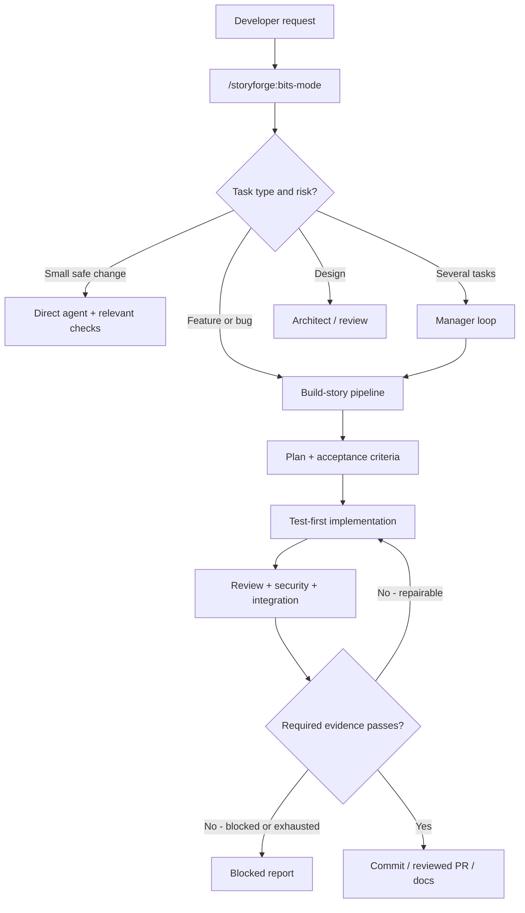
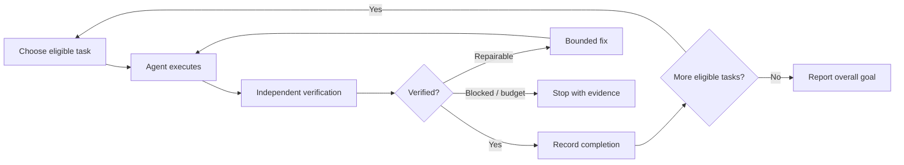

# StoryForge

**One command. An engineering team of specialized Claude Code agents. Verified progress instead of promises.**

StoryForge is a Claude Code plugin for turning tasks and user stories into tested, reviewed changes. The single recommended command is `/storyforge:bits-mode`. The manager routes your request to planning, coding, security, testing, architecture, investigation, documentation and delivery workflows as needed.

> **Maturity:** early-stage engineering tooling. Read [Limits and honest caveats](#limits-and-honest-caveats) before unattended use. An agent claiming success is not equivalent to a passing test or approved PR.

## At a glance

| Need | What Bits-Mode does | How you know it worked |
|---|---|---|
| Build an application | Plan features and integration boundaries; delegate one verified story at a time | Tested changes, acceptance criteria and documented constraints |
| Add a feature | Read project memory, plan, develop, review and integrate | Explicit test outcomes and a Git diff |
| Fix a defect | Investigate cause, add regression tests, repair and reverify | Reproducing test passes after the fix |
| Improve architecture | Delegate design analysis before changing code | Decision rationale and identified trade-offs |
| Handle several tasks | Build a dependency-aware queue and isolate parallel work | Status ledger, branches and PR evidence |

## Architecture



**Control principle:** models decide how to perform engineering work. Scripts, test results, approval rules and CI must decide whether work is complete.

## Installation

In Claude Code, use the **public GitHub repository**:

```text
/plugin marketplace add https://github.com/amitesh04081988/storyforge
/plugin install storyforge@storyforge
```

Requirements: Claude Code, Git, Bash (Git Bash for Windows), and working Python 3. GitHub PR features need `gh`; browser-based UI verification needs a Node.js / Playwright setup.

In an existing application:

```text
/storyforge:init-project
/storyforge:bits-mode Add a searchable customer list with pagination
```

Review the generated `storyforge.config.json` and set real test, lint and typecheck commands. **Do not trust the default npm commands unless they exist in your project.**

## Three developer examples

### Example 1: Build a NestJS + Next.js application

```text
/storyforge:bits-mode Create a gym management MVP:
NestJS API, Next.js frontend, PostgreSQL, memberships,
attendance and admin login. Design the data model and
API contracts before coding. Deliver in small tested stories.
```

The manager should decompose this into verifiable increments, identify authentication as sensitive, request needed approvals, and report missing dependencies instead of inventing test results. It is **not** guaranteed to finish an entire application unattended.

### Example 2: Debug a production-style defect

```text
/storyforge:bits-mode Investigate why order exports duplicate
records when a queue worker retries. Reproduce with a regression
test, fix the root cause, test concurrency and explain the change.
```

Expect investigation and a bounded fix loop. Do not use automated retries for non-idempotent production operations.

### Example 3: Multiple independent tasks

```text
/storyforge:bits-mode Add CSV export, improve API documentation,
and fix login redirect behavior. Track dependencies, use isolated
worktrees for independent stories, and create reviewable PRs.
```

The manager uses a local task ledger and scoped worktrees. Parallel headless stories remain a pilot feature until end-to-end integration tests establish reliability.


### Durable state and deterministic verification (new)

The command `bits-tasks.sh` now uses SQLite (`.storyforge/tasks.sqlite`) for transactional task claims, event history and SHA/config-bound gate records. This **is a breaking change for old local TSV ledgers**; export/reconcile existing `.storyforge/tasks.tsv` before enabling the SQLite workflow. A task cannot be marked DONE on an agent's word alone.

```bash
# Run from a trusted application repository after StoryForge installation
bash "${CLAUDE_PLUGIN_ROOT}/scripts/bits-tasks.sh" add "Implement search" --mode light
bash "${CLAUDE_PLUGIN_ROOT}/scripts/bits-tasks.sh" claim --limit 1
# After implementation, commit the change and record distinct identities:
bash "${CLAUDE_PLUGIN_ROOT}/scripts/bits-tasks.sh" identity 1 builder-agent verifier-agent
bash "${CLAUDE_PLUGIN_ROOT}/scripts/bits-tasks.sh" set 1 verifying
bash "${CLAUDE_PLUGIN_ROOT}/scripts/bits-tasks.sh" verify 1 --verifier verifier-agent
bash "${CLAUDE_PLUGIN_ROOT}/scripts/bits-tasks.sh" attest 1
bash "${CLAUDE_PLUGIN_ROOT}/scripts/bits-tasks.sh" set 1 done
```

For full-mode tasks, independent `review` and `security` gates are also mandatory. The local verifier cannot automatically prove these; their evidence must be recorded by the appropriate independent verification workflow. Missing gates block attestation. Working-tree changes must be committed before SHA-based verification; this keeps verification reproducible.

## Loop engineering: what is supported?



StoryForge has **manager**, **fix** and **PR/CI** loops with bounded stops. These are **goal-oriented engineering workflows**, not a native recurring scheduler. Claude Code's native `/goal`, `/loop` or `/schedule` availability varies by environment. StoryForge does **not** install a persistent scheduler or automatically subscribe to GitHub events.

## Safety and verification

- Small changes use lightweight routing. Authentication, payment, migration, permissions and other high-risk work require full review regardless of file count.
- Project state is persisted under `.storyforge/` and story documentation; a model's completion statement is not proof.
- Required tests, lint, typecheck and any affected integration/UI gates must pass; missing required checks are blockers.
- **The Stop hook is a development aid, not a CI or security boundary.** It may let a chat end after repeated failures; that must not imply success.
- New installations use `ship.auto_merge: true`, behind two gates: `pr-watch.sh` must say READY (all checks passed, the names in `STORYFORGE_REQUIRED_CHECKS` present) and the PR's head commit must have a recorded verdict. The merge uses `--match-head-commit`. Set it to `false` to merge by hand. Existing configs are not changed.
- Only run the plugin on trusted repositories or inside a restricted sandbox. A repository's test commands are executable commands.
- When CI has no configured checks, the PR watcher must not declare the PR ready.

## Why this helps developers

For developers, Bits-Mode reduces repeated coordination: it looks for existing code, uses project conventions, scopes changes and produces test-first increments. For tech leads, it standardizes review and captures rationale, impact and acceptance evidence. For teams, it gives a more reviewable PR and durable project knowledge. The value depends on **real tests and oversight**: the plugin cannot guarantee correctness by itself.

## Architecture and developer documentation

Continue below for detailed installation, command reference, phases, dependency tracking, memory layout, team coordination, and caveats.

---

## Detailed documentation

For complete configuration options, skills, agents, hooks and long-form behavior see [the developer reference](docs/DEVELOPER_REFERENCE.md). For the deterministic ledger migration see [migration guidance](docs/MIGRATION.md). For current implementation boundaries and loop contracts see [engineering architecture](docs/ENGINEERING_ARCHITECTURE.md).

**Status:** This is early-stage tooling. Existing tests validate individual mechanics, not full autonomous Claude Code application delivery. The scheduler, external webhook intake, and multi-machine task coordination are not implemented.
