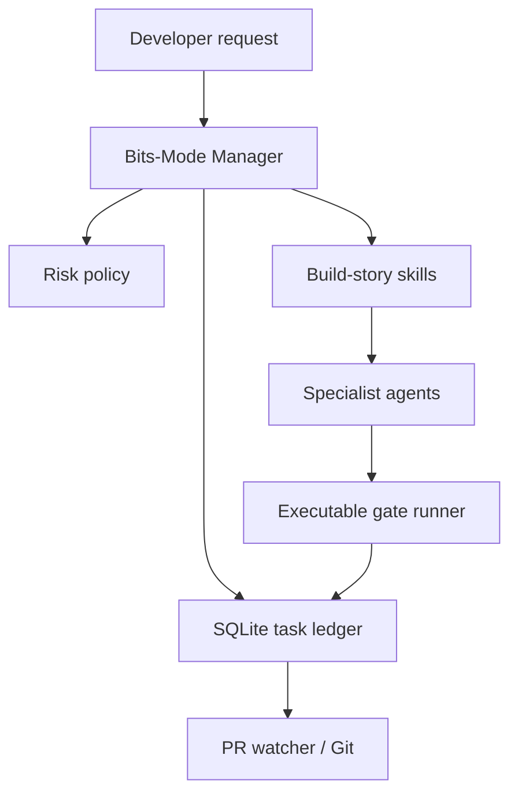

# StoryForge Engineering Architecture

StoryForge is a Claude Code plugin using a skills-based manager, Bash hooks, and Python's standard-library SQLite for single-host task persistence. It is not an always-on server.

## Execution model

## Bounded loops

| Loop | Progress | Success | Failure/stop |
|---|---|---|---|
| Manager | Claim and verify eligible tasks | All proof-backed tasks done | Blocker or no progress |
| Fix | Code change and rerun gates | Passing required checks | Attempt cap or ambiguity |
| PR | Observe CI and reviewers | Required checks and current SHA | Closed, failed or unavailable |
| Scheduled | Not implemented | Not applicable | Disabled by default |

Task state is transactional and requires configured gate evidence bound to the current clean Git HEAD, base and config. Agents can perform work but cannot establish completion solely by saying it is finished.

## Known boundaries

- The state engine is single-host; it is not a distributed queue or process supervisor.
- The independent gate runner executes configured test/lint/typecheck commands; it cannot automatically attest model-generated security review claims.
- Time-based and proactive Claude Code loops are optional external integrations, not native StoryForge features.
- Cancel records state but does not yet forcibly terminate all child processes.
- Run only in a trusted repository or restricted sandbox. Test and lint commands are executable code.
- Production deployment, destructive migrations, customer messages and privileged actions require explicit approval.

## Core files

- `plugins/storyforge/skills/bits-mode/SKILL.md`: user-facing manager and routing
- `plugins/storyforge/scripts/bits-policy.py`: deterministic risk floor
- `plugins/storyforge/scripts/bits-state.py`: SQLite state, evidence and attempts
- `plugins/storyforge/scripts/verify-run.py`: real executable gate results
- `plugins/storyforge/scripts/pr-watch.sh`: conservative CI decision
- `plugins/storyforge/hooks/stop-gate.sh`: best-effort session gate
- `tests/`: regression fixtures
