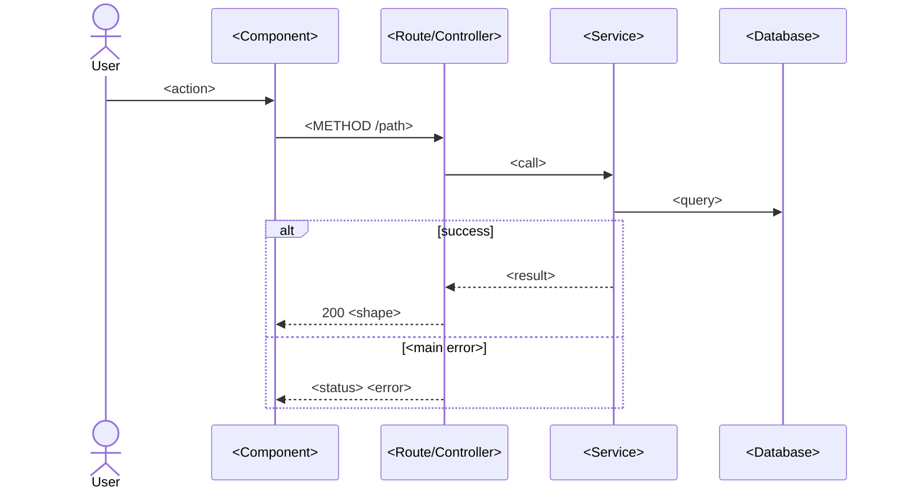

# <Feature name>
Story: [<id>](../stories/<id>/story.md) · Last updated: <date>

## What it does
<!-- 3–5 lines, user's point of view; acceptance criteria satisfied -->

## Main flow

## States / logic
<!-- stateDiagram-v2 or flowchart, only if the feature has a lifecycle or branching -->

## Data changes
<!-- erDiagram fragment for new/changed tables -->

## Key files
- `path/to/file` — role

## Integrations
- [<name>](../memory/integrations/<name>.md) — what this feature uses

## Tests
- Unit: `path` · Integration: `path` · E2E: `e2e/<feature>.spec.ts`

## Gotchas
- 
